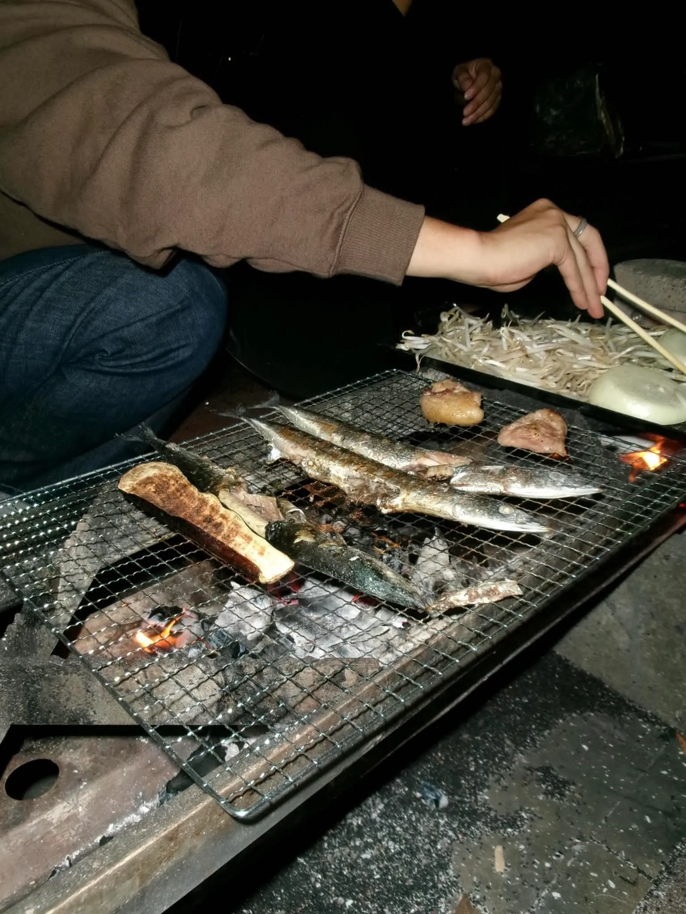
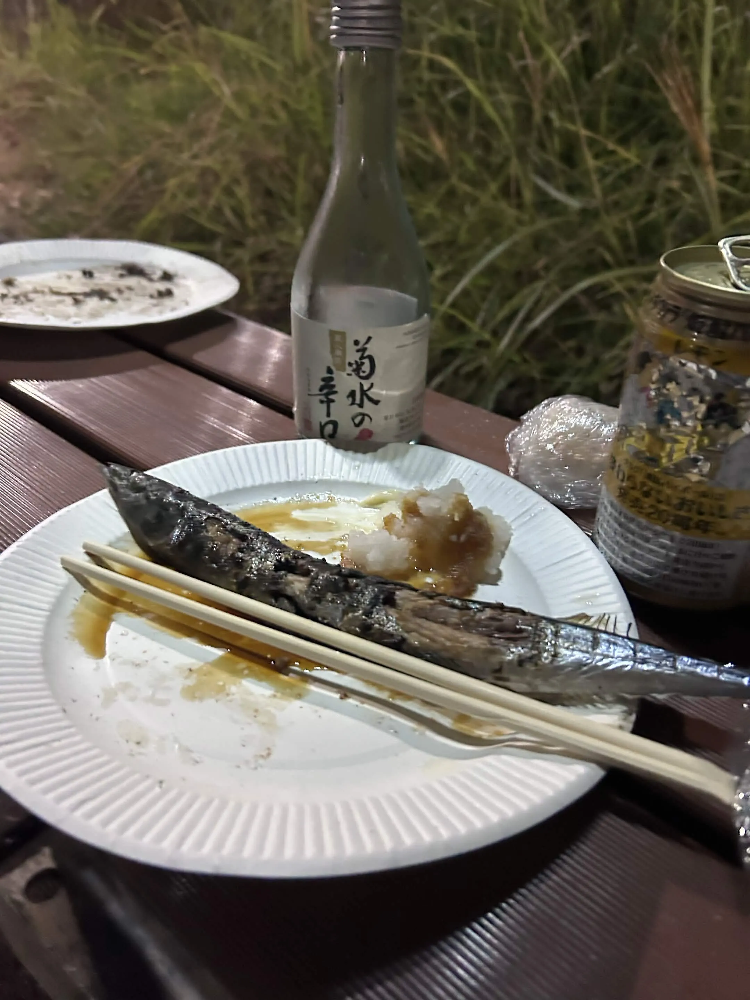
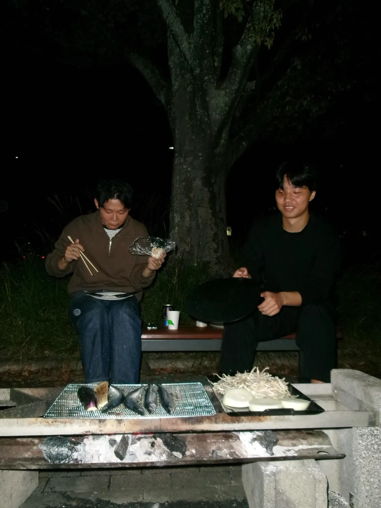

秋の風が少しずつ街を包みはじめ、涼しい空気に季節の移り変わりを感じるようになりました。  
はじめまして、B3の山田です！

読書の秋、スポーツの秋、そして研究の秋。いろいろありますが、今回はお腹の声に従って「食欲の秋」を楽しむことにしました！

ということで、莊司研究室で秋の味覚を楽しむ「サンマ会」を開催しました。  
きっかけは、「秋だし、サンマが食べたい！」のひと言。開催理由はシンプルですが、食欲は十分です。

食材は莊司先生が用意してくださいました。先生、ありがとうございます！  
サンマに加えて、焼き肉、豚汁、炊き込みご飯までそろう、なんとも豪華な顔ぶれに。サンマ会のはずが、主役級のメニューが勢ぞろいです。これは胃袋も忙しくなりそうです。

まずはサンマで秋を感じ、焼き肉に箸を伸ばし、豚汁でほっとひと息。そして炊き込みご飯もいただきます。  
「お腹いっぱい」と「もうひと口」が、胃袋の中で何度も議論することになりました。こういうときの「もうひと口」は、なかなかの説得力です。

秋の味覚をたっぷり味わって、お腹も心も大満足。ごちそうさまでした！  
食材を用意してくださった莊司先生、あらためてありがとうございました。

しっかり食べて、研究へのエネルギーも充電完了です。あとは、この満腹感に誘われる眠気との勝負……！

今年の秋も、研究とおいしいご飯、どちらも全力で楽しんでいきます。  
莊司研、食欲の秋・研究の秋、どちらも本気です！
