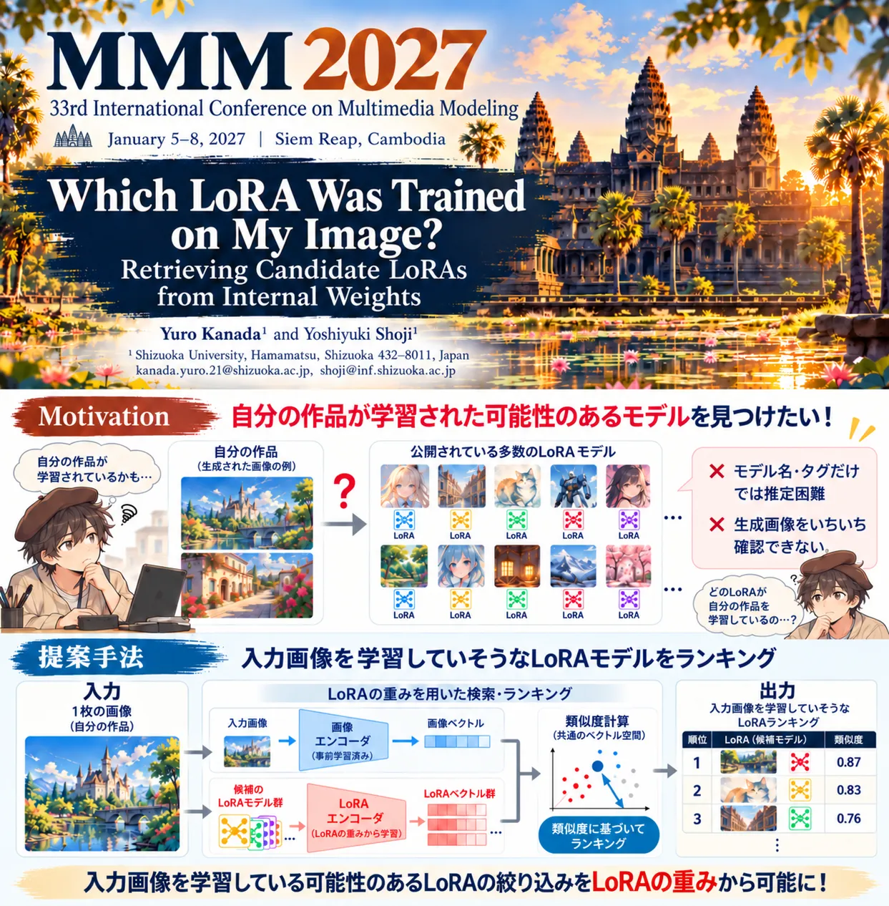

2027年に開催される、マルチメディア分野における主要な国際会議の一つであるThe 33rd International Conference on Multimedia Modeling（MMM2027）にて、M2の金田悠路さんの論文がFull Paperとして採択されました。

- **Which LoRA Was Trained on My Image? Retrieving Candidate LoRAs from Internal Weights**, Yuro Kanada and Yoshiyuki Shoji, Proc. of The 33rd International Conference on Multimedia Modeling (MMM 2027), to appear, 2027.

MMM2027については[こちら](https://mmm2027.net/)。

2027年1月にカンボジアのシェムリアップにて発表予定です。
