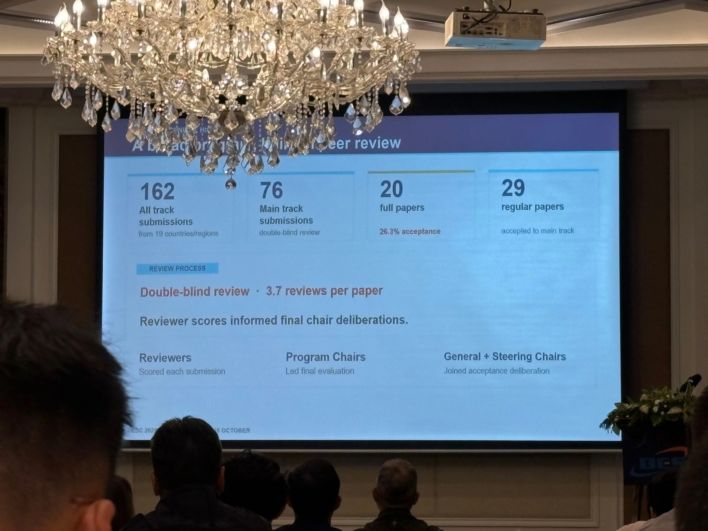
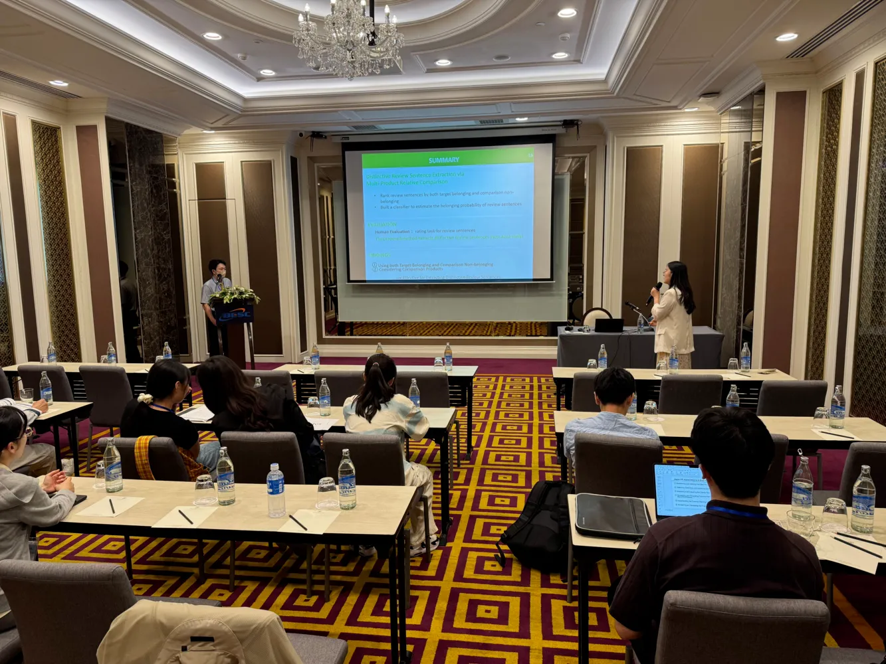
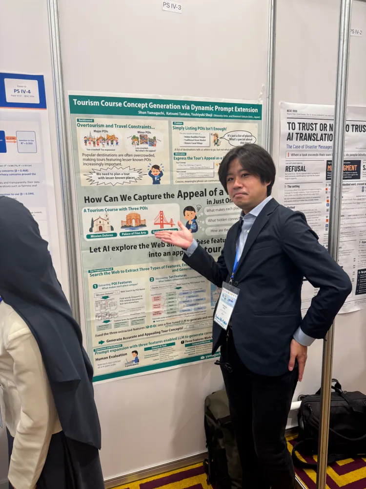

สวัสดีครับ

寒さに負けて、既にこたつで丸くなり始めている矢崎です。

2026年10月26日から28日にかけて、タイ・バンコクで開催された **The 13th International Conference on Behavioural and Social Computing (BESC2026)** において、M1矢崎、莊司先生が研究発表を行いました。

BESCは、人間の行動や社会現象を計算機によって分析・モデル化する「行動・ソーシャルコンピューティング」を扱う国際会議であり、人工知能、計算社会科学、自然言語処理、ビジネス・マーケティング、心理学など幅広い分野の研究者が集まります。
今回は、2026 IEEE Region 10 Humanitarian Technology Conference (R10-HTC)との併催で、参加者はどちらの発表も聴講できるようになっていました。

今年は、Main TrackのFull Paper採択率は26.3%と報告されており、20本がFull Paper、29本がRegular Paperで採択されました。

本研究室からは2件の論文が採択されました。
矢崎の研究はMain TrackのFull Paperで、莊司先生が発表した山口君の研究はRegular Paperで採択されました。

会場は、タイ・バンコクにあるThe Berkeley Hotel Pratunam Bangkokにて開催されました。
Main TrackのFull Paperは12分の口頭発表、Regular Paperはポスター発表でした。
今回は、山口君が来られなかったため、先生が代わりに発表を行いました。

発表はすべて英語で行われ、質疑応答でも海外研究者との議論が求められます。
発表前は緊張もありましたが、無事に発表を終えることが出来ました。

### 矢崎の口頭発表の様子

### 矢崎コメント

初めての海外・初めての国際会議で、緊張とワクワクを胸に参加しました。
英語の発表・質疑応答は非常に緊張しましたが、問題なく終えることができて嬉しく思います。
残念なことに現地で風邪を引いてしまい、参加できなかった催しがあり後悔が残る部分もありましたが、非常に良い経験をさせていただきました。
今回このような機会を得られたのは自分一人の力ではなく、研究や論文執筆、海外での活動に至るまでさまざまな面からサポートしてくださった莊司先生、共著者の先生、研究室のメンバー、家族など、たくさんの方々の支えがあったからこそです。本当にありがとうございます。
今後もこのような貴重な機会を得られるように、より研究活動に邁進していきたいと思います。
今後ともよろしくお願いします！

### 先生のポスター発表の様子

 

### 書誌情報

発表した論文の書誌情報は以下です。

- **Distinctive Review Sentence Extraction via Multi-Product Relative Comparison**, Naoto Yazaki, Katsumi Tanaka, Yoshiyuki Shoji, Proc. of The 13th International Conference on Behavioural and Social Computing (BESC2026), 2026.
- **Tourism Course Concept Generation via Dynamic Prompt Extension**, Shun Yamaguchi, Katsumi Tanaka, Yoshiyuki Shoji, Proc. of The 13th International Conference on Behavioural and Social Computing (BESC2026), 2026.

 

BESC2026の公式サイトは[こちら](https://besc-conf.org/2026/)

prodeedingsは[こちら](https://link.springer.com/book/10.1007/978-981-92-6910-5)
