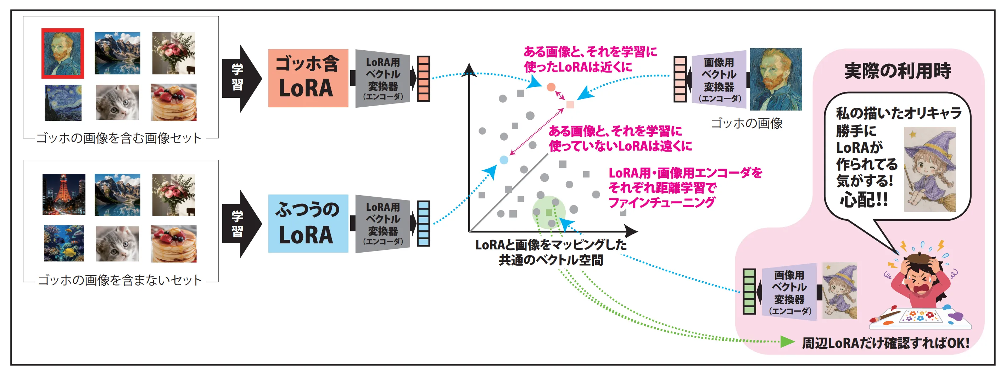

自分の作品が、勝手に画像生成AIの学習に使われているかも…？学習データからAIモデルを検索！

この研究では、ある画像を学習に使った可能性のある画像生成AIの追加学習モデル（LoRA）を、その内部パラメータから検索する手法を提案しています。

画像生成AIにどんな絵を描かせられるかではなく、**「そのAIが何を学習したのか」** に注目して、大量に公開されているモデルの中から、調査すべきモデルの候補を探し出します。

研究背景

最近では、画像生成AIを追加学習して、特定の画風やキャラクターなどを再現できるようにした「LoRA」と呼ばれるモデルが数多く公開されるようになってきています。
とくに、CivitaiやHuggingFaceなどのモデル共有サイトでは、様々な作品を使って勝手に学習したLoRAファイルが数多くアップロードされ、共有されています。

イラストレーターや画家の人たちの中には、「自分の作品が許可なくAIの学習に使われているかもしれない」という危機感を持つ人もいます。
一方で、あるモデルが本当にその人の絵を学習に使ったかどうかを、そのAIモデルから判別することは、原理的に不可能です。
実際にとれる手段は、疑わしいモデルを発見し、その投稿者に問い合わせ、自分の画像を学習に使っていないか照会をかけることだけです。
･･･ところが、数万件公開されているモデルから、疑わしいモデルを発見することは、困難です。

提案内容

そこでこの研究では、ある画像を入力すると、それを学習に使った可能性のある順にLoRAをランキングできる、LoRA検索アルゴリズムを考えました。

LoRAの内部には、追加学習によって変化した大量の数値が保存されています。これらの数値には、何を学習したかについての情報が含まれている可能性があります。

そこで、画像とLoRAの内部パラメータという、まったく異なる2種類の情報を、それぞれ比較可能なベクトルに変換するAIを学習させました。

このとき、実際に学習に使われた画像とLoRAの組み合わせはベクトルが近くなり、そうでない組み合わせは遠くなるように学習させます。

こうしておけば、調べたい画像を1枚入力するだけで、あらかじめ登録しておいた大量のLoRAとベクトルの近さを比較し、その画像を学習に使った可能性が高い順にLoRAを並べることができます。

また、検索対象となるLoRAを追加するときにも、その内部パラメータをベクトルに変換して登録するだけでよく、個別に画像を生成する必要はありません。

こうしたアルゴリズムを実現するため、一般公開されている西洋画科の大規模データを使って、たくさんのLoRAを実際に学習してみました。
こうすることで、どのモデルがどの画像を学習したのかを紐づけしたデータセットを作ることができました。
こうして作成したデータセットで、LoRAモデルとクエリ画像それぞれをベクトル化するエンコーダを学習しました。

実験と分かったこと

作成したアルゴリズムが実際に使えるかを確認するため、複数の画家の作品を混ぜて学習したLoRAを大量に用意し、「この絵を学習したAIはどれ？」という検索問題として評価実験を行いました。

そのために、任意の入力画像に対して、

- LoRAに実際に画像を生成させて、入力画像と似た絵を出すモデルを探す手法、
- 今回提案したAIの内部パラメータから直接探す方法

で、それぞれ実際にモデルのランキングを行い、正解がどれだけ上位に来ているかを比較しました。

提案手法は相対的に高精度で、特に、未知の画家を含む実験では、上位20件で拾えた正解LoRAの割合が約30％から約49％に向上しました。

さらに、同じ画家の異なる作品を学習したLoRAを比較すると、個別の学習画像に関係する情報も、わずかながら内部パラメータに残っていることが分かりました。

つまり、AIが生成する絵を見なくても、AIの「中身」から学習元の手がかりを探せることが示されました
（ただし、本技術は学習の事実を確定するものではなく、疑わしいモデルを絞り込む技術です）。

提案手法の概要と想定利用シナリオ。画像セットでLoRAを作成し、2種類のエンコーダを距離学習。利用時は侵害を検出したい画像を入力。

## 文献情報
- タイトル：
    - Which LoRA Was Trained on My Image? Retrieving Candidate LoRAs from Internal Weights
- 著者：
    - Yuro Kanada, Yoshiyuki Shoji
- 書誌情報：
    - Proc. of The 33rd International Conference on Multimedia Modeling (MMM 2027), to appear, 2027